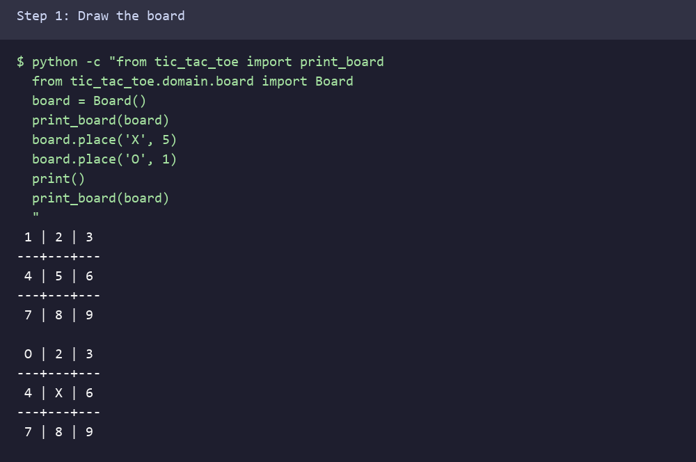
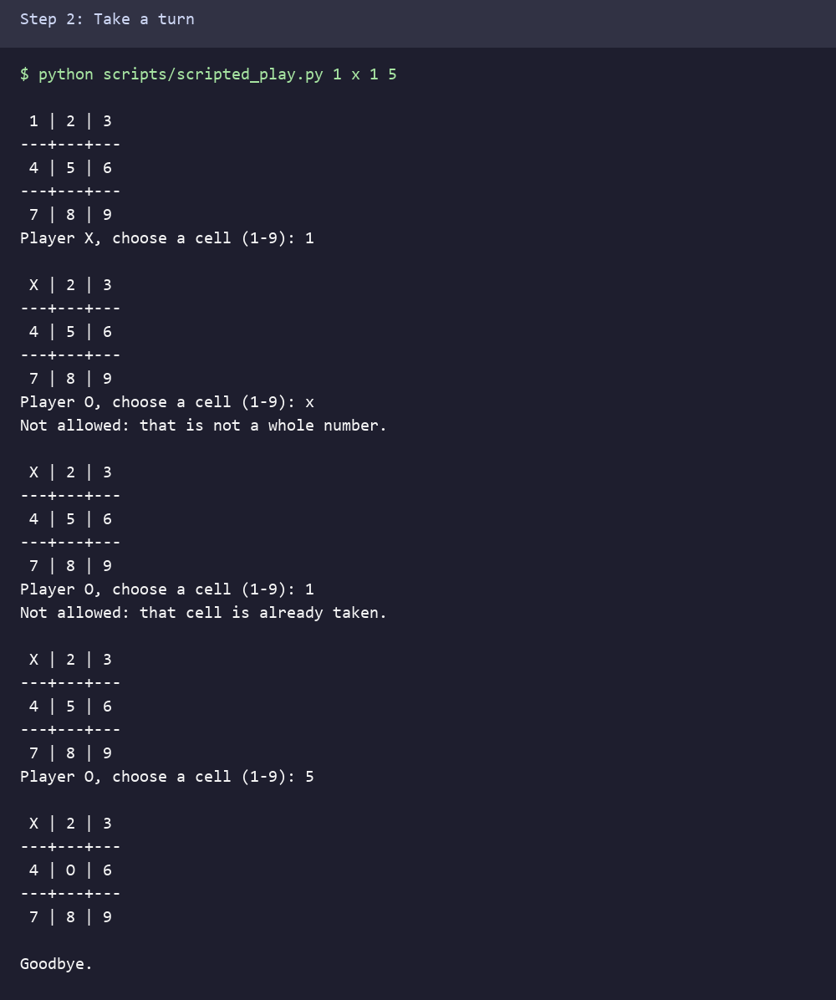
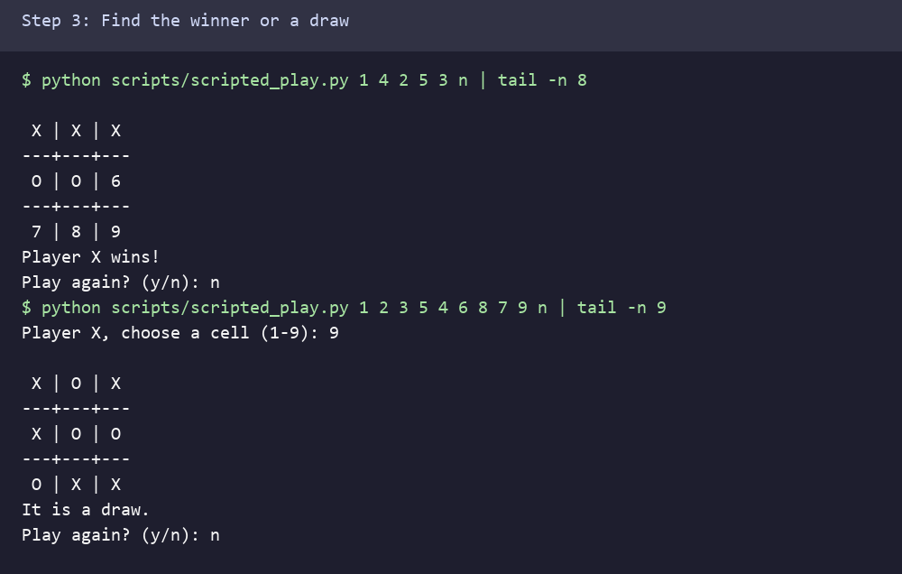
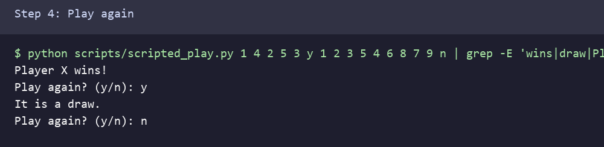

# 🚀 084 Tic Tac Toe

Day 84 of Udemy's *100 Days of Code: The Complete Python Pro Bootcamp*: a text-based Tic Tac Toe game for two players. It is for course participants who want runnable, tested code with the assignment's function names, and for anyone who browses the repository for ideas.

## 📚 Table of Contents

- [Overview](#-overview)
- [Requirements](#-requirements)
- [Setup](#-setup)
- [Run](#-run)
- [The four steps](#-the-four-steps)
- [Tests](#-tests)
- [License](#-license)
- [Links](#-links)
- [Appendix: Project documents](#-appendix-project-documents)

## 🧭 Overview

The assignment is to build a text-based version of Tic Tac Toe. This repository solves it as a small project: a use case and its design come first, the code follows the design, and a wiki in English, Danish and Bahasa Malaysia explains what each step teaches.

| Folder | What it holds |
| --- | --- |
| `src/` | The game, in the layers `domain`, `application` and `presentation` of the design |
| `tests/` | Tests that follow the use case and the operation contract |
| `docs/` | Project documents, the use case and its design (`docs/use-cases/uc-001/`, `docs/dcd.md`) and the wiki sources (`docs/wiki/`) |
| `scripts/` | `scan.sh` (the opengrep scan), `make_screenshots.py` (the screenshots below) and `scripted_play.py` (plays a game from the command line) |
| `framework/` | The SQA and QC framework (a git submodule) that the project documents follow |
| `Doxyfile` | The Doxygen configuration; the source uses Doxygen comments |
| `.editorconfig` | The editor settings of the framework baseline |
| `.env.example` | Placeholders for the git host tokens that the framework scripts read; the program itself reads no setting from `.env` |

The project is built in gateways (see the [Project Plan][PP-001]), one branch and one pull request for each, so the history shows the steps.

## 📋 Requirements

- Python 3.13 or newer, to run the code.
- No runtime dependency: the game uses the standard library only.
- `pytest`, `ruff`, `mypy` and Pillow, only for development; they are installed with the `dev` extra.
- Doxygen, only to build the source documentation.

## 🛠️ Setup

Create and use a local virtual environment named `.venv`, then bring `pip` up to date and install the project.

Windows (PowerShell):

```powershell
python -m venv .venv
.venv\Scripts\Activate.ps1
python -m pip install --upgrade pip
python -m pip install -e ".[dev]"
```

Linux and macOS:

```bash
python3 -m venv .venv
source .venv/bin/activate
python -m pip install --upgrade pip
python -m pip install -e ".[dev]"
```

Leave out `[dev]` if you only want to play. `deactivate` leaves the environment.

## ▶️ Run

Play a game of Tic Tac Toe in the terminal. Two players share the keyboard; `X` starts and the cells are numbered 1 to 9:

```bash
python -m tic_tac_toe
```

After the install, the command `tic-tac-toe` does the same. The game needs no package from the internet; only the Python standard library is used.

The functions of the assignment are available from the package:

```python
from tic_tac_toe import check_winner, is_board_full, play_game, print_board
```

| Function | What it does |
| --- | --- |
| `print_board(board)` | Draws the board; an empty cell shows its number |
| `check_winner(board, mark)` | Tells whether the mark has a row, a column or a diagonal |
| `is_board_full(board)` | Tells whether no cell is empty, so a game without a winner is a draw |
| `play_game()` | Plays games on the terminal until the players say no to another game |

A game that `X` wins (the moves are 1, 4, 2, 5 and 3):

```text
 1 | 2 | 3
---+---+---
 4 | 5 | 6
---+---+---
 7 | 8 | 9
Player X, choose a cell (1-9): 1
...
 X | X | X
---+---+---
 O | O | 6
---+---+---
 7 | 8 | 9
Player X wins!
Play again? (y/n): n
```

A move that is not allowed (a taken cell, a number outside 1 to 9, or something that is not a number) is refused with the reason, and the same player is asked again. Press `Ctrl+C` or end the input to stop at any time.

## 🪜 The four steps

The assignment grows in four steps. Each step below says in words what it builds, with a screenshot of the program's own output; the screenshots are made by `scripts/make_screenshots.py` in a Docker container, so they come from the code in this repository.

### Step 1: Draw the board

A board is nine cells that hold a mark or are empty. `print_board(board)` draws three rows of three cells with lines between them. An empty cell shows its number, so a player sees which number to type.



### Step 2: Take a turn

The player whose turn it is types the number of a cell. The game puts the player's mark there and draws the board again. A choice that is not allowed (not a number, outside 1 to 9, or a cell that is taken) is refused with the reason, and the same player is asked again.



### Step 3: Find the winner or a draw

After each move the game asks `check_winner(board, mark)` whether the mark has a row, a column or a diagonal. If not, `is_board_full(board)` tells whether the game is a draw. Otherwise the other player is next.



### Step 4: Play again

`play_game()` wraps the game in a loop. After the result it asks whether to play again; `y` or `yes` starts a game on an empty board and any other answer ends the program.



To make the screenshots again, start Docker and run:

```bash
python scripts/make_screenshots.py
```

## 🧪 Tests

```bash
python -m pytest
```

Before pushing, scan the files with opengrep (default path `~/.opengrep/cli/latest/opengrep.exe`; `git add` new files first, because opengrep scans tracked files):

```bash
bash scripts/scan.sh
```

Build the source documentation with Doxygen (the output goes to `docs/doxygen/`, which git ignores):

```bash
doxygen Doxyfile
```

## 📄 License

GNU Affero General Public License v3.0 only (AGPL-3.0-only), see [LICENSE][license].

## 🔗 Links

- [Repository][repository]
- [Documentation][documentation]
- [Issue tracker][issues]

## 📎 Appendix: Project documents

The documents a newcomer needs, in reading order.

| Document | What it tells you |
| --- | --- |
| [Business Case][BC-001] | Why the project exists, its scope and success criteria |
| [Stakeholder Analysis][SA-001] | Who is involved; the stakeholder IDs used for owners and reviewers |
| [Project Plan][PP-001] | The gateways and their schedule |
| [Milestones][milestones] | One document per gateway: Go/No-Go criteria and tasks |
| [Use case][UC-001] | What the game does for its players |
| [Design Class Diagram][DCD-001] | The classes and methods the code follows |
| [Artifact registry][registry] | Where each artifact type lives, the next version, the PO language and domain |
| [Domain dictionary][DICT-001] | The PO terms and the IT terms |
| [Framework README][framework-readme] | The framework this project uses |
| [Framework changelog][framework-changelog] | What changed in each framework release |

---

[repository]: https://git.tirsystem.com/Tirsvad-Udemy-100-days-of-code/084-assignment-tic-tac-toe
[documentation]: https://git.tirsystem.com/Tirsvad-Udemy-100-days-of-code/084-assignment-tic-tac-toe/wiki
[issues]: https://git.tirsystem.com/Tirsvad-Udemy-100-days-of-code/084-assignment-tic-tac-toe/issues
[license]: ./LICENSE
[BC-001]: ./docs/business-case.md
[SA-001]: ./docs/stakeholder-analysis.md
[PP-001]: ./docs/project-plan.md
[milestones]: ./docs/milestones/
[UC-001]: ./docs/use-cases/uc-001/uc.md
[DCD-001]: ./docs/dcd.md
[registry]: ./docs/artifact-registry.md
[DICT-001]: ./docs/dictionary.md
[framework-readme]: ./framework/README.md
[framework-changelog]: ./framework/CHANGELOG.md
