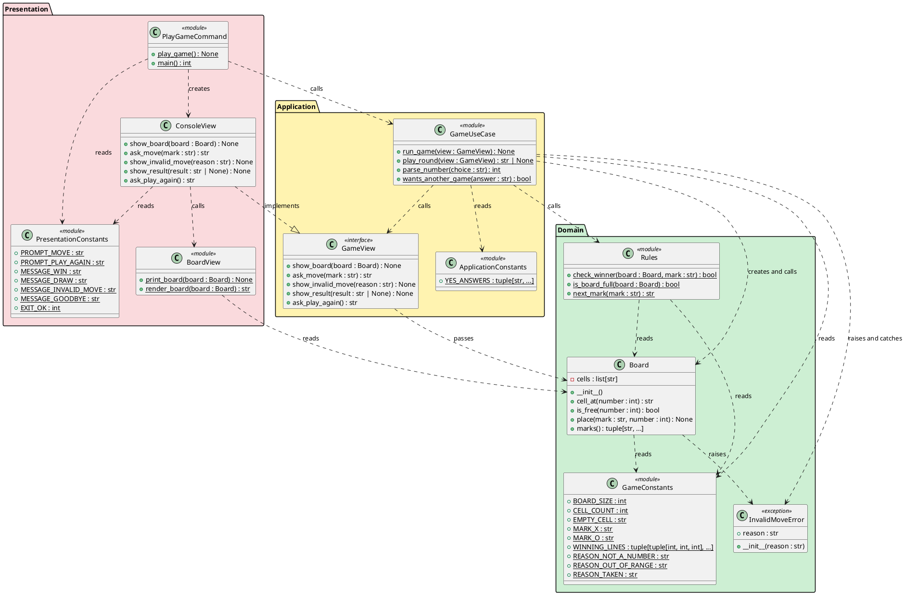

# Design Class Diagram

## Metadata
| Key | Value |
| --- | --- |
| ID | DCD-001 |
| CrossReference | [DM-001], [SD-001], [DICT-001] |

## Version History
| Date | Status | Author | Reviewer | Change | Commit |
| --- | --- | --- | --- | --- | --- |
| 2026-11-19 | Accepted | Jens Tirsvad Nielsen | S01 | Initial version Reviewed in RC-017: Go | pending |

---

## Purpose and Scope

Defines the classes and methods that realise [SD-001] (the sequences of `startGame`, `makeMove` and `chooseAnotherGame`). It answers the concerns CN-001, CN-003 and CN-004 of [SA-001] (a game that follows the rules, that S02 can run and that has the assignment's function names) and serves the developers: S01 and, as readers, S02. Python has no static class, so a design class marked `<<module>>` is implemented as a Python module of functions and constants; a class marked `<<exception>>` or `<<interface>>` is a Python class (the interface is a `typing.Protocol`). The package is `tic_tac_toe`.

## Diagram

The nine cells of the `Board` are plain strings (one `mark` or `EMPTY_CELL` each) held in the attribute `cells`, so the Domain Model concept Cell is not a class of its own. Package dependencies are Presentation → Application, Presentation → Domain and Application → Domain, all pointing inward; the interface `GameView` is owned by the Application and implemented by the outer `ConsoleView`.

## Class Table

| Class | Refines (Domain Model concept) | Responsibility | Attributes | Operations |
| --- | --- | --- | --- | --- |
| `PlayGameCommand` | none: a technical class (the entry point and composition root) | Builds the view, starts the game and ends the program cleanly on end of input or an interrupt | none | `play_game`, `main` |
| `ConsoleView` | none: a technical class (the terminal adapter of `GameView`) | Shows the board, the reasons and the result, and reads the choice and the answer | none | `show_board`, `ask_move`, `show_invalid_move`, `show_result`, `ask_play_again` |
| `BoardView` | Board, Cell, Mark | Draws the rows of the board with the mark or the number of each cell | none | `print_board`, `render_board` |
| `PresentationConstants` | none: a technical class (texts and exit code) | Holds the prompts, the messages and the exit code | `PROMPT_MOVE`, `PROMPT_PLAY_AGAIN`, `MESSAGE_WIN`, `MESSAGE_DRAW`, `MESSAGE_INVALID_MOVE`, `MESSAGE_GOODBYE`, `EXIT_OK` | none |
| `GameView` | none: a technical class (the port of the use case) | Names what the use case needs from the outside: show, ask | none | `show_board`, `ask_move`, `show_invalid_move`, `show_result`, `ask_play_again` |
| `GameUseCase` | Game, Player, Move, Result | Runs the rounds of a game, alternates the `marks`, parses the `choice` and judges the end | none | `run_game`, `play_round`, `parse_number`, `wants_another_game` |
| `ApplicationConstants` | none: a technical class (the words that mean yes) | Holds the answers that mean yes | `YES_ANSWERS` | none |
| `Board` | Board, Cell, Mark | Keeps the nine cells, knows which is free and puts a `mark` in one | `cells` | `__init__`, `cell_at`, `is_free`, `place`, `marks` |
| `Rules` | Winning Line, Result | Tells whether a `mark` has a `line`, whether the `board` is full and which `mark` is next | none | `check_winner`, `is_board_full`, `next_mark` |
| `GameConstants` | Board, Mark, Winning Line | Holds the size, the marks, the eight lines and the reasons | `BOARD_SIZE`, `CELL_COUNT`, `EMPTY_CELL`, `MARK_X`, `MARK_O`, `WINNING_LINES`, `REASON_NOT_A_NUMBER`, `REASON_OUT_OF_RANGE`, `REASON_TAKEN` | none |
| `InvalidMoveError` | Move | Tells that a `move` is not allowed and why | `reason` | `__init__` |

SOLID: each class has one responsibility; the use case depends on the Domain and on its own interface `GameView` only (dependency inversion, [ADR-0002]); no class is a god class.

## Method Traceability

| Method signature | Operation Contract / SD message |
| --- | --- |
| `PlayGameCommand.play_game() -> None` | `play_game()` in the sequence `startGame` of [SD-001] |
| `PlayGameCommand.main() -> int` | `play_game()` in [SD-001]: the entry point that runs it and returns `EXIT_OK` |
| `ConsoleView.show_board(board: Board) -> None` | `show_board(board)` in the sequences `startGame` and `makeMove` of [SD-001] |
| `ConsoleView.ask_move(mark: str) -> str` | `ask_move(mark)` in the sequence `makeMove` of [SD-001] |
| `ConsoleView.show_invalid_move(reason: str) -> None` | `show_invalid_move(reason)` in the sequence `makeMove` of [SD-001]; the exceptions of `makeMove` in [OC-001] |
| `ConsoleView.show_result(result: str \| None) -> None` | `show_result(mark)` and `show_result(none)` in the sequence `makeMove` of [SD-001] |
| `ConsoleView.ask_play_again() -> str` | `ask_play_again()` in the sequence `chooseAnotherGame` of [SD-001] |
| `BoardView.print_board(board: Board) -> None` | `show_board(board)` in [SD-001]: the drawing behind it |
| `BoardView.render_board(board: Board) -> str` | `show_board(board)` in [SD-001]: the text of the drawing |
| `GameView.show_board`, `ask_move`, `show_invalid_move`, `show_result`, `ask_play_again` | the same messages as `ConsoleView`, which implements them ([ADR-0002]) |
| `GameUseCase.run_game(view: GameView) -> None` | `run_game(view)` in [SD-001]; `chooseAnotherGame` in [OC-001] |
| `GameUseCase.play_round(view: GameView) -> str \| None` | `play_round(view)` in [SD-001]; `startGame` and `makeMove` in [OC-001] |
| `GameUseCase.parse_number(choice: str) -> int` | `parse_number(choice)` in [SD-001]; the first exception of `makeMove` in [OC-001] |
| `GameUseCase.wants_another_game(answer: str) -> bool` | `wants_another_game(answer)` in [SD-001]; `chooseAnotherGame` in [OC-001] |
| `Board.__init__() -> None` | `create()` of `Board` in [SD-001]; the postconditions of `startGame` in [OC-001] |
| `Board.cell_at(number: int) -> str` | `check_winner(board, mark)` in [SD-001], which reads the cells |
| `Board.is_free(number: int) -> bool` | `place(mark, number)` in [SD-001], which checks the cell first |
| `Board.place(mark: str, number: int) -> None` | `place(mark, number)` in [SD-001]; the postconditions and the second exception of `makeMove` in [OC-001] |
| `Board.marks() -> tuple[str, ...]` | `show_board(board)` and `is_board_full(board)` in [SD-001], which read the cells in order |
| `Rules.check_winner(board: Board, mark: str) -> bool` | `check_winner(board, mark)` in [SD-001] |
| `Rules.is_board_full(board: Board) -> bool` | `is_board_full(board)` in [SD-001] |
| `Rules.next_mark(mark: str) -> str` | `next_mark(mark)` in [SD-001] |
| `InvalidMoveError.__init__(reason: str) -> None` | `create(reason)` in [SD-001], the exceptions of `makeMove` in [OC-001] |

The package `tic_tac_toe` also exports `print_board`, `check_winner`, `is_board_full` and `play_game` from its `__init__` module so that S02 can import the assignment's names; that export adds no method.

## Pattern Annotations

| Pattern | Classes | Rationale |
| --- | --- | --- |
| Controller (GRASP) | `PlayGameCommand` | Receives the system operation; the layout "one command per use case" of `clean-architecture` |
| Information Expert (GRASP) | `Board`, `Rules`, `GameConstants` | The cells, the lines and the rules to read them are together in the Domain |
| Protected Variations (GRASP) | `GameView`, `InvalidMoveError` | One interface protects the use case from the terminal; one error protects callers from the reasons |
| Adapter (GoF) | `ConsoleView` | Adapts the terminal to `GameView` |

## Dependency Check

No circular dependency: Presentation → Application → Domain and Presentation → Domain; no Domain class depends on an outer layer, and every dependency points inward. `GameView` is the only interface and is owned by the Application; `ConsoleView` in the Presentation implements it. The program has no Infrastructure package: the standard streams used by `ConsoleView` are those of the Python runtime and are not a class of the design.

---

[DM-001]: ./domain-model.md
[SD-001]: ./use-cases/uc-001/sd.md
[OC-001]: ./use-cases/uc-001/oc.md
[DICT-001]: ./dictionary.md
[SA-001]: ./stakeholder-analysis.md
[ADR-0002]: ./adr/adr-0002-console-is-reached-through-a-view-interface.md
