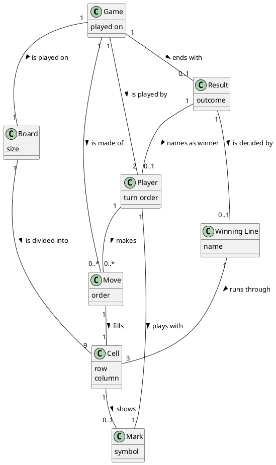

# Domain Model

## Metadata
| Key | Value |
| --- | --- |
| ID | DM-001 |
| CrossReference | [UC-001], [UCD-001], [SSD-001], [DICT-001] |
| Language | en |
| Domain | it |

## Version History
| Date | Status | Author | Reviewer | Change | Commit |
| --- | --- | --- | --- | --- | --- |
| 2026-11-19 | Accepted | Jens Tirsvad Nielsen | S01 | Initial version Reviewed in RC-012: Go | pending |

---

## Purpose and Scope

Covers [UC-001] Play a Game of Tic Tac Toe. It answers the concern CN-001 of [SA-001] (the game follows the rules and is tested) and serves S01, the Product Owner, and the domain experts: what a game of Tic Tac Toe is made of.

## Diagram

Concepts, attributes and associations only — no operations.

## Concept Table

| Concept | Definition | Attributes | Source (use case / glossary) |
| --- | --- | --- | --- |
| Game | One play of Tic Tac Toe from an empty Board to a Result | played on | "Game" in [UC-001], steps 1 and 9a |
| Board | The grid of three rows and three columns on which a Game is played | size | "Board" in [UC-001], step 2 |
| Cell | One of the nine places of the Board | row, column | "Cell" in [UC-001], step 4 |
| Player | One of the two people who play, first or second | turn order | "Player" in [UC-001], step 1 |
| Mark | The symbol, `X` or `O`, that a Player puts in a Cell | symbol | "Mark" in [UC-001], step 5 |
| Move | A Player's choice of one Cell for their Mark | order | "Move" in [UC-001], step 4 |
| Winning Line | Any of the eight lines of three Cells: a row, a column or a diagonal | name | "Winning Line" in [UC-001], step 6 |
| Result | How a Game ended: a win for a Player or a draw | outcome | "Result" in [UC-001], step 7 |

## Association Table

| From | Association (reading direction) | To | Multiplicity |
| --- | --- | --- | --- |
| Game | is played on | Board | 1 to 1 |
| Game | is played by | Player | 1 to 2 |
| Game | is made of | Move | 1 to 0..* |
| Game | ends with | Result | 1 to 0..1 (0 while the Game is in progress) |
| Board | is divided into | Cell | 1 to 9 |
| Cell | shows | Mark | 1 to 0..1 (0 while the Cell is free) |
| Player | plays with | Mark | 1 to 1 |
| Player | makes | Move | 1 to 0..* |
| Move | fills | Cell | 1 to 1 |
| Winning Line | runs through | Cell | 1 to 3 |
| Result | names as winner | Player | 1 to 0..1 (0 for a draw) |
| Result | is decided by | Winning Line | 1 to 0..1 (0 for a draw) |

## Generalizations

None.

---

[UC-001]: ./use-cases/uc-001/uc.md
[UCD-001]: ./use-case-diagram.md
[SSD-001]: ./use-cases/uc-001/ssd.md
[DICT-001]: ./dictionary.md
[SA-001]: ./stakeholder-analysis.md
