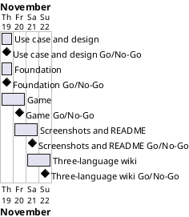

# Project Plan

## Metadata
| Key | Value |
| --- | --- |
| ID | PP-001 |
| CrossReference | [BC-001], [SA-001], [MIL-001], [MIL-002], [MIL-003], [MIL-004], [MIL-005], [US-001] |
| Language | en |
| Domain | it |

## Version History
| Date | Status | Author | Reviewer | Change | Commit |
| --- | --- | --- | --- | --- | --- |
| 2026-11-19 | Accepted | Jens Tirsvad Nielsen | S01 | Initial version<br>Reviewed in RC-003: Go | pending |

---

## Purpose

This plan schedules five gateways that turn the Day 84 assignment "Tic Tac Toe" into a designed, tested repository and a three-language wiki, inside the Business Case constraint of completion by 2026-11-22. The design comes first: no code is written before the use case, its Sequence Diagram and the Design Class Diagram are accepted ([MIL-001]).

## Planning Assumptions

- The plan starts 2026-11-19 and ends 2026-11-22, per the Business Case constraint ([BC-001]).
- One branch and one pull request per gateway; each pull request closes its issues.
- Stakeholders are served as [SA-001] sets out: S01 accepts the plan in chat; S02 and S03 are informed through the README and the wiki.
- Autonomous mode: once S01 has accepted this plan, the work runs through all gateways: each document is created, reviewed, accepted, committed and pushed, the pull request is opened and merged when its checks are green. Every review record says `Mode: autonomous, not independent`.
- The Product Owner (PO) language is English and the PO domain is IT (information technology). The wiki also exists in Danish and Bahasa Malaysia.
- The git host is `git.tirsystem.com`; the repository is the `origin` of this checkout. The tokens are read from `.env`, which is never printed, committed or read by the program.
- The lecture is summarised only; no screenshot or text of the lecture is used. Screenshots show the program's own output from a Docker container.
- The one user story US-001 has the one use case UC-001; all code tasks of [MIL-003] cite it and the design artifacts it leads to.

## Gateway Schedule

| Gateway | Document | Window | Decision date | Owner | Stories | Main deliverable | Milestone |
| --- | --- | --- | --- | --- | --- | --- | --- |
| Use case and design | [MIL-001] | 2026-11-19 | 2026-11-19 | S01 | [US-001] | User story, use case diagram, use case, Domain Model, SSD, OC, SD, DCD, dictionary, two ADRs | [Milestone 631][ms-631] |
| Foundation | [MIL-002] | 2026-11-19 | 2026-11-19 | S01 | none (technical tasks) | Project configuration, Doxyfile, scan script, set-up guide, repository description and topics | [Milestone 632][ms-632] |
| Game | [MIL-003] | 2026-11-19 to 2026-11-20 | 2026-11-20 | S01 | [US-001] | Tested `tic_tac_toe` package and command line, built from the design | [Milestone 633][ms-633] |
| Screenshots and README | [MIL-004] | 2026-11-20 to 2026-11-21 | 2026-11-21 | S01 | none (technical tasks) | Four step screenshots, README | [Milestone 634][ms-634] |
| Three-language wiki | [MIL-005] | 2026-11-21 to 2026-11-22 | 2026-11-22 | S01 | none (technical tasks) | Wiki in en, da and ms with Linux and Windows guides, traceability matrix | [Milestone 635][ms-635] |



## Scope Coverage

| Business Case scope item | Gateway |
| --- | --- |
| The Day 84 assignment, summarised in words | [MIL-004], [MIL-005] |
| The use case, the design artifacts and their reviews | [MIL-001] |
| `pyproject.toml`, `.gitignore`, `.venv` guide, `.editorconfig`, `.env.example`, Doxyfile | [MIL-002] |
| Repository description and topics | [MIL-002] |
| Python package under `src/`, tests under `tests/`, command line | [MIL-003] |
| Doxygen comments | [MIL-003] |
| Screenshots of the program per lecture step | [MIL-004] |
| README | [MIL-004] |
| Wiki in en, da and ms with Linux and Windows guides | [MIL-005] |
| Local opengrep scan before every push | [MIL-002], [MIL-003], [MIL-004], [MIL-005] |

## Dependencies

```
MIL-001 → MIL-003 → MIL-004 → MIL-005
MIL-002 → MIL-003
```

A No-Go on a gateway holds the later gateways; S01 decides whether the end date 2026-11-22 moves, and records the move in a new Version History row of this plan.

## Plan Risks

| Risk | Impact | Mitigation |
| --- | --- | --- |
| The git host is unreachable or a token lacks a scope | Issues, pull requests, the description or the wiki cannot be published | The work stays on local branches; the run stops and reports |
| Docker is not running, so the screenshots cannot be produced in a container | Gateway [MIL-004] is blocked | Stop and report; the host's desktop is never used as a fallback (`framework/process/gui-testing.md`) |
| A design artifact fails its review | Code cannot start | The artifact is fixed and reviewed again; after three failed rounds on one cause the work stops and S01 decides |
| A continuous integration (CI) check fails on a pull request | The merge is delayed | The failure is fixed on the same branch and the checks run again; after three failed rounds on one cause the work stops and S01 decides |

## Open Issues

- The request names `https://git.tirsystem.com/Tirsvad-Udemy-100_days_of_code` (underscores); that address redirects to the organisation `Tirsvad-Udemy-100-days-of-code` of the `origin` of this checkout. The plan uses `origin`.
- The assignment text is one sentence and its downloadable resources are not available to the author. The function names (`print_board`, `check_winner`, `is_board_full`, `play_game`) and the four lecture steps (draw the board, take a turn, find the winner or a draw, loop with play again) are taken from the solutions fellow participants share. If S01 supplies the lecture's own names or steps, they replace these in a new Version History row.
- The repository is public, so the prompt log folder is listed in `.gitignore` and is not tracked.
- No governance document and no Entity Relationship Diagram are planned: the program stores nothing, and the traceability matrix is the single-project minimum.
- No artifact names or credits an automated assistant (request of S01); the framework's review wording is therefore `Mode: autonomous, not independent` without naming who stood in.

---

[BC-001]: ./business-case.md
[SA-001]: ./stakeholder-analysis.md
[US-001]: ./user-stories.md
[MIL-001]: ./milestones/mil-001-use-case-and-design.md
[MIL-002]: ./milestones/mil-002-foundation.md
[MIL-003]: ./milestones/mil-003-game.md
[MIL-004]: ./milestones/mil-004-screenshots-and-readme.md
[MIL-005]: ./milestones/mil-005-wiki.md
[ms-631]: https://git.tirsystem.com/Tirsvad-Udemy-100-days-of-code/084-assignment-tic-tac-toe/milestone/631
[ms-632]: https://git.tirsystem.com/Tirsvad-Udemy-100-days-of-code/084-assignment-tic-tac-toe/milestone/632
[ms-633]: https://git.tirsystem.com/Tirsvad-Udemy-100-days-of-code/084-assignment-tic-tac-toe/milestone/633
[ms-634]: https://git.tirsystem.com/Tirsvad-Udemy-100-days-of-code/084-assignment-tic-tac-toe/milestone/634
[ms-635]: https://git.tirsystem.com/Tirsvad-Udemy-100-days-of-code/084-assignment-tic-tac-toe/milestone/635
