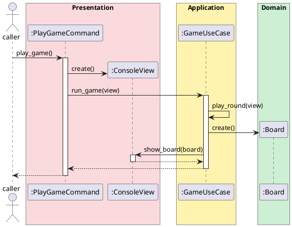
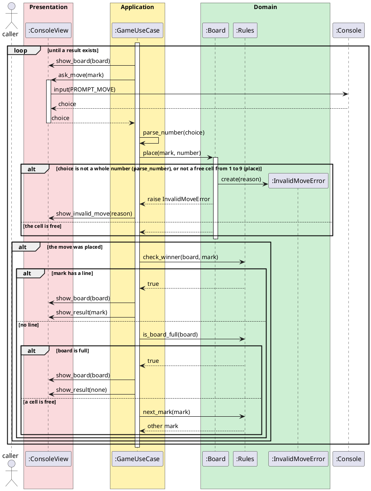
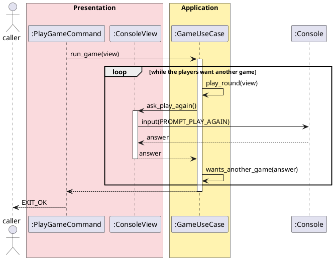

# Sequence Diagram

## Metadata
| Key | Value |
| --- | --- |
| ID | SD-001 |
| CrossReference | [OC-001], [DCD-001], [DICT-001] |

## Version History
| Date | Status | Author | Reviewer | Change | Commit |
| --- | --- | --- | --- | --- | --- |
| 2026-11-19 | Accepted | Jens Tirsvad Nielsen | S01 | Initial version Reviewed in RC-016: Go | pending |

---

## Purpose

This document answers the concerns CN-001 (a game that follows the rules and is tested), CN-003 (run from the README) and CN-004 (the assignment's function names) of [SA-001], and serves the developers: S01, and S02 as a reader. It realizes the three contracts of [OC-001]: `startGame`, `makeMove` and `chooseAnotherGame`.

The system has three layers: Presentation (the command and the console view), Application (the use case and the `GameView` interface it owns) and Domain (the board, the rules and the error). It has no Infrastructure layer: the standard streams of the Python runtime (`Console`) are the only outside object, and the program reads no file, no environment variable and no network. A call across a layer boundary goes through the interface of the inner layer: the use case calls `GameView`, which `ConsoleView` implements ([ADR-0002]).

## Sequence: startGame

**Realizes:** `startGame` in [OC-001]

### Diagram

### Postcondition Coverage

| Postcondition (from contract) | Satisfied by message |
| --- | --- |
| A `game` instance was created | `run_game(view)` starts a `game`; `play_round(view)` is its first round |
| A `board` instance was created and associated with `game` | `create()` of `Board` in `play_round(view)` |
| Nine `cell` instances numbered 1 to 9 were created, none with a `mark` | `create()` of `Board` fills nine `cells` with `EMPTY_CELL` |
| Two `player` instances with the `marks` `X` and `O` were created | `play_round(view)` takes `MARK_X` and `MARK_O` of `GameConstants` as the two `players` |
| The first `player` is next | `play_round(view)` starts with `MARK_X` |

## Sequence: makeMove

**Realizes:** `makeMove` in [OC-001]

### Diagram

### Postcondition Coverage

| Postcondition (from contract) | Satisfied by message |
| --- | --- |
| A `move` was created and associated with `game`, the `player` and the `cell` | `place(mark, number)` fills the `cell` of `number` with the `mark` of the `player` |
| The `cell` shows the `mark` of the `player` | `place(mark, number)` |
| A `result` with the `player` as winner and the `line` was created when a `line` holds three of the `mark` | `check_winner(board, mark)` returns true; `show_result(mark)` |
| A `result` without winner was created when every `cell` shows a `mark` | `is_board_full(board)` returns true; `show_result(none)` |
| Otherwise the other `player` is next | `next_mark(mark)` |
| Exception: no `move`, no change, same `player` next, reason signalled | `create(reason)` of `InvalidMoveError` raised by `place(mark, number)` or `parse_number(choice)`; `show_invalid_move(reason)`; the loop asks the same `mark` again |

## Sequence: chooseAnotherGame

**Realizes:** `chooseAnotherGame` in [OC-001]

### Diagram

### Postcondition Coverage

| Postcondition (from contract) | Satisfied by message |
| --- | --- |
| A new `game` with its `board`, `cells` and `players` was created when the answer is yes, and `true` returned | `wants_another_game(answer)` returns true, so the loop calls `play_round(view)` again |
| No `game` instance was created when the answer is anything else, and `false` returned | `wants_another_game(answer)` returns false, so the loop ends and `run_game(view)` returns |

## Pattern Annotations

| Pattern (GRASP / GoF) | Applied to | Rationale |
| --- | --- | --- |
| Controller (GRASP) | `PlayGameCommand` | It receives the system operation from the caller and hands the work to the use case; it holds no rule of the game |
| Information Expert (GRASP) | `Board`, `Rules` | `Board` owns the cells, so it knows which cell is free; `Rules` owns the lines, so it knows when a `mark` has one |
| Low Coupling (GRASP) | `GameUseCase` | It depends on the Domain and on the `GameView` interface only, so a test can play a game with a scripted view and no terminal |
| Protected Variations (GRASP) | `GameView`, `InvalidMoveError` | The use case does not change when the terminal changes; a caller handles one specific error, not every `ValueError` |
| Adapter (GoF) | `ConsoleView` | It adapts the terminal to the `GameView` interface of the Application ([ADR-0002]) |

## Responsibility Check

No object receives all messages. `PlayGameCommand` builds the view and starts the use case; `ConsoleView` talks to the terminal; `GameUseCase` runs the turns; `Board` keeps the cells; `Rules` judges the lines; `InvalidMoveError` carries the reason. Each has one reason to change (the entry point, the terminal, the flow of a game, the board, the rules of winning, the error).

---

[OC-001]: ./oc.md
[DCD-001]: ../../dcd.md
[DICT-001]: ../../dictionary.md
[SA-001]: ../../stakeholder-analysis.md
[ADR-0002]: ../../adr/adr-0002-console-is-reached-through-a-view-interface.md
