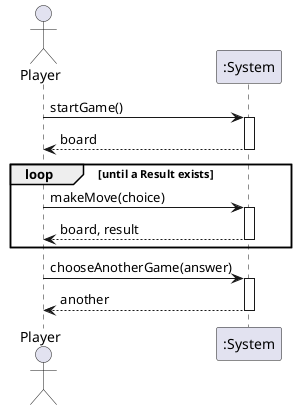

# System Sequence Diagram

## Metadata
| Key | Value |
| --- | --- |
| ID | SSD-001 |
| CrossReference | [UC-001], [DM-001], [OC-001] |
| Language | en |
| Domain | it |

## Version History
| Date | Status | Author | Reviewer | Change | Commit |
| --- | --- | --- | --- | --- | --- |
| 2026-11-19 | Accepted | Jens Tirsvad Nielsen | S01 | Initial version Reviewed in RC-014: Go | [b31f4b3] |

---

## Source Use Case

Play a Game of Tic Tac Toe ([UC-001]) — scenario: main success scenario. The extension 4a (a Move that is not allowed) is a failure of the same operation `makeMove` and is described in the Exceptions of [OC-001]; the extensions 9a and *a are shown by the answer in `chooseAnotherGame` and by the end of the program, and have no diagram of their own.

## Diagram

## System Operations

| Step | Message | Parameters | Return | Use case step |
| --- | --- | --- | --- | --- |
| 1 | `startGame` | none | `board` (Board) | Steps 1 and 2: the Player starts a Game and the system shows the empty Board |
| 2 | `makeMove` | `choice` (the text the Player gave to choose a Cell) | `board` (Board), `result` (Result, none while the Game is in progress) | Steps 3 to 7: the system asks for a Cell (3), the Player chooses (4), the system places the Mark (5), checks the Winning Lines (6) and tells the Result when there is one (7) |
| 3 | `chooseAnotherGame` | `answer` (the Players' answer) | `another` (whether a new Game starts) | Steps 8 and 9: the system asks for another Game and acts on the answer |

Steps 3 and 6 of the use case are internal to the system; only the choice goes in and the Board and the Result come out.

## Lifecycle Notes

A Game exists from `startGame` until the Result has been shown. A new `startGame` is made by `chooseAnotherGame` when the answer is yes. The system keeps nothing between two runs of the program.

---

[UC-001]: ./uc.md
[DM-001]: ../../domain-model.md
[OC-001]: ./oc.md
[b31f4b3]: https://git.tirsystem.com/Tirsvad-Udemy-100-days-of-code/084-assignment-tic-tac-toe/commit/b31f4b369e5e2228605a7241d1d616a68a5108ce
